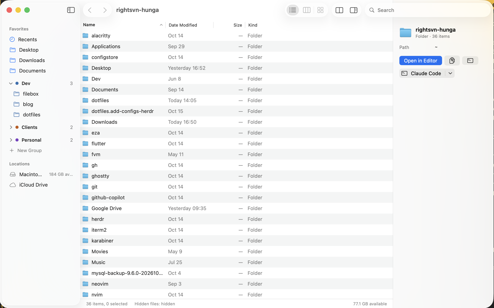

  

# Filebox

A keyboard-first file manager for macOS, built for developers.

## Screenshot

  

## Features

- **Fast browsing**: folders load asynchronously; a folder with 20,000 files opens in under a second.
- **Sortable list**: Name, Date Modified, Size and Kind columns, folders always listed first.
- **Keyboard navigation**: open with Enter or ⌘↓, go back and forward with ⌘[ and ⌘], go to the enclosing folder with ⌘↑.
- **Type to select**: start typing a name to jump to the matching file.
- **Go to Folder** (⌘⇧G): type a path with `~` support and folder autocomplete.
- **Hidden files**: toggle with ⌘⇧. or from the status bar; hidden items are dimmed.
- **Live updates**: the list refreshes when files change on disk, keeping the selection and scroll position.
- **Parent folder menu**: click the window title to jump to any parent folder.
- **Preview pane** (⌘⇧P): shows the kind, size, modified date and full path of the selected item.
- **Clear error states**: missing folders and folders without read permission show what went wrong.
- **Native look**: system colors and SF Symbols, following the system appearance.
